### 2026/11/27 v4.0 Update
- **網線 / WiFi 自動雙切**：單一韌體同時支援網線與 WiFi，不再分 firmware-e / firmware-w。
  - 網線優先：插上網線即自動關閉 WiFi（含熱點）。
  - 網線拔除 / 斷線：自動開啟 WiFi 連回原本設定的 SSID；30 秒內連不上才會跳出熱點 `automate-pm-20d-xxxxxx` 供重新配網。
  - 停電復電：WiFi 路由器晚點才恢復也沒關係，設備會持續重試並自動連回，熱點隨之關閉。
- **狀態 LED**：斷網（網線與 WiFi 皆未連）每秒閃一次；連線後常亮。
- **實體按鈕**：長按 5 秒起 LED 快閃，此時放開＝重開機；長按滿 10 秒 LED 熄滅，此時放開＝出廠重置（含清除 WiFi 設定與所有計費設定）。
- 修正「自動歸零模式」未連 HA 時每日 00:00 不會觸發的問題（改用設備自身 SNTP 時間）。
- **新增保存最近 3 次計費週期紀錄**：每次歸零（手動按 `TaiPower Count Manual Reset` 或自動歸零）時，自動把該期的總度數、累計電費與歸零日期封存，HA 會多出 9 個實體：
  - `(Taipower) Prev1 kWh` / `Prev1 Cost` / `Prev1 Reset Date`（最近一期）
  - `(Taipower) Prev2 ...`（前兩期）、`(Taipower) Prev3 ...`（前三期）
  - 紀錄存在設備 flash 內，斷電不會遺失；新裝置或剛出廠重置時顯示 `—` / 0，要等第二次歸零起才有完整一期可封存。
- OTA 統一讀取 `firmware-we`。

# 3.8 版更新內容 [詳細](https://github.com/Billtou/public/blob/main/PM_20/PM_20_v2/beta/3_8_0_update_readme.md)
*「台電帳單對齊:雙月級距 + 跨季日數比例切割」

*「精準計價:支援台電雙月抄表 + 跨季日數分配」

*「電費計算對齊台電 114/10 公告(雙月 + 跨季)」
# PM-20 Display Version
* 新增耗電量顯示輪播LED顯示螢幕，間隔10秒顯示累計耗電度數、本期累計電費、耗電瓦數以及每小電費預估。背光開關可按黑色按鈕切換
### V3.6 beta 版新增內容
* 修正累計用電 kWh entity 無法清零問題。(按清零後須等待數個每隔20秒更新一次的過程才會全數歸零)
### V3.5 beta 版新增內容
* 修正 entity last_reset error 的問題
### V3.4 beta 版新增內容
* 不需要在HA 自建功耗表，全部能源面板所需的entity id 都由本版本堤供
* 3.0 beta說明步驟3.與4.省略，由本版本直接取代
### v3.0 beta 版新增內容
* 不需要安裝Taipower插件的版本
* 本版本主要功能是自帶HA能源面板所需兩個必需entity，以及本期累計電費跟及時小時能耗成本。另外日後台電若電價調整，直接修改默認的計價參數即可。

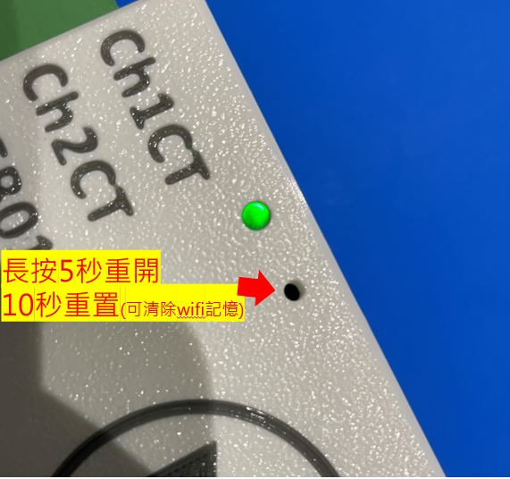
## 接入自家網路(WIFI)
* 不插網線上電，稍待約 30 秒手機靠近設備找wifi熱點 automate-pm-20d-xxxxxx，接入後手機切換到瀏覽器輸入192.168.4.1即可指定自家wifi與密碼，HA會自動找到設備。
## 接入自家網路(網線)
* 上電插上網線即可，插上網線時 WiFi 與熱點會自動關閉（v4.0 起同一韌體自動雙切，拔掉網線會自動切回 WiFi）。
## 匯流排式電箱介紹
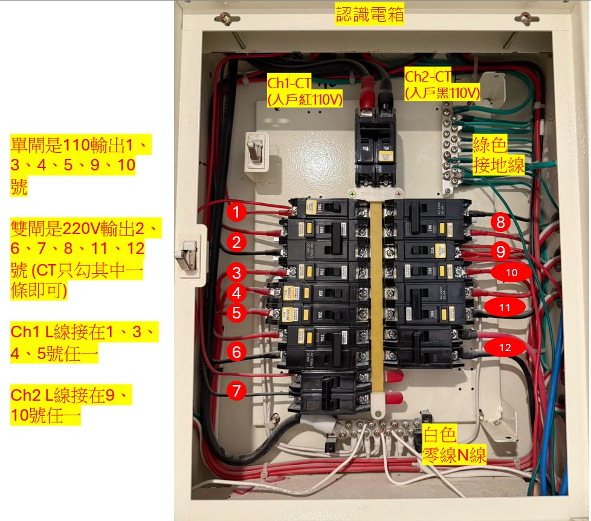
## 一般式電箱介紹
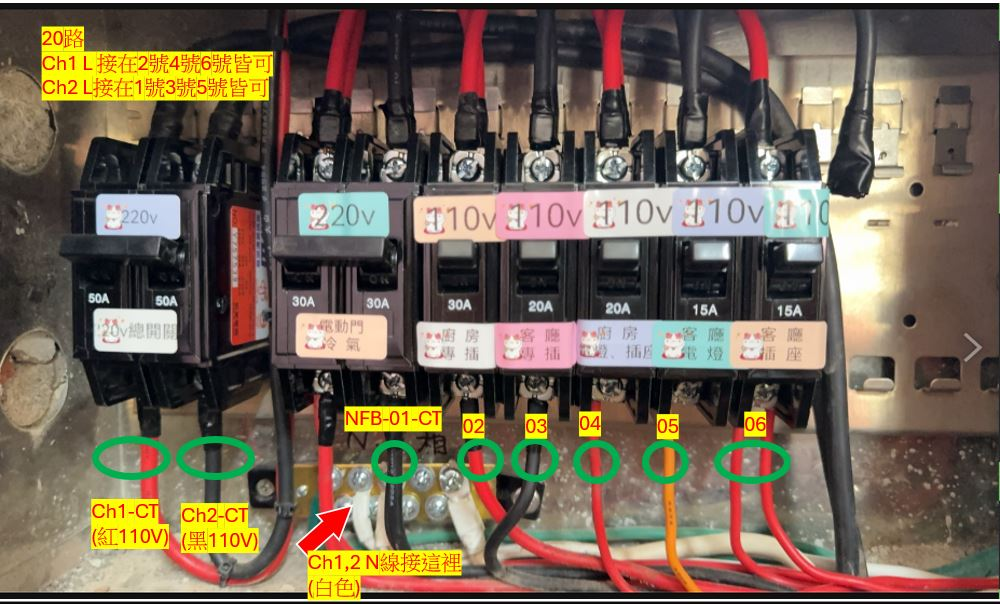
## 1.接線說明
* (ch1-L,N 與ch2-L各接在兩邊匯流排110V NFB 上，別裝在220V的NFB上，建議左邊接紅色110V，右邊裝黑色)

   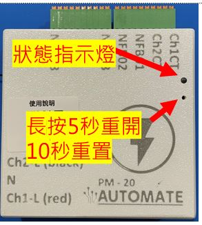
   
## 2.設備硬體安裝順序
* (entity ID 名稱視個別略為不同請自行調整)
* 請先將電源接上並連接網路後，CT訊號線先接好插入設備接口，最後最後再依序將CT一一勾上電線並檢查鉤環卡扣是否正確扣住。

## 5. 設定HA能源面板架構-電網
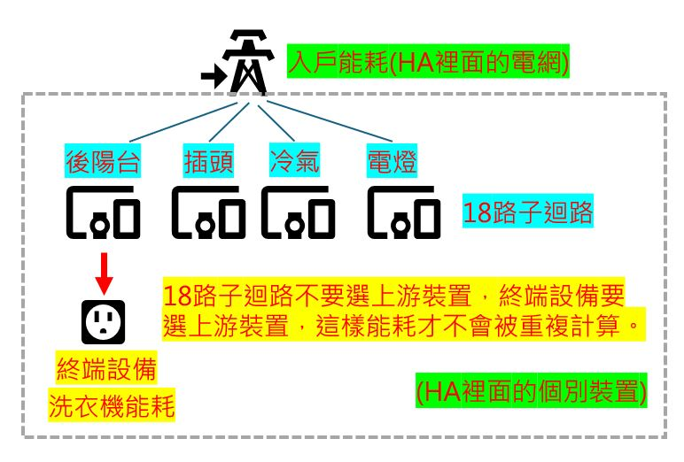
* 設定  >  儀錶板  > 能源  依序填入必要entity即可。(正確的id名稱請見下方7. 實體說明 篇)
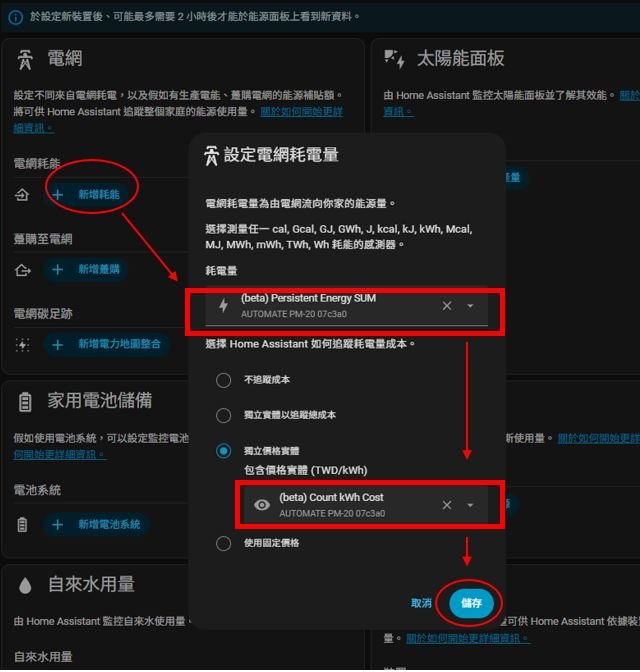
## 6. 設定HA能源面板-個別裝置
* 接入18個迴路，末端個別裝置(例如s31能耗插頭)必須指定其中一個迴路為上游以避免重複計算能耗
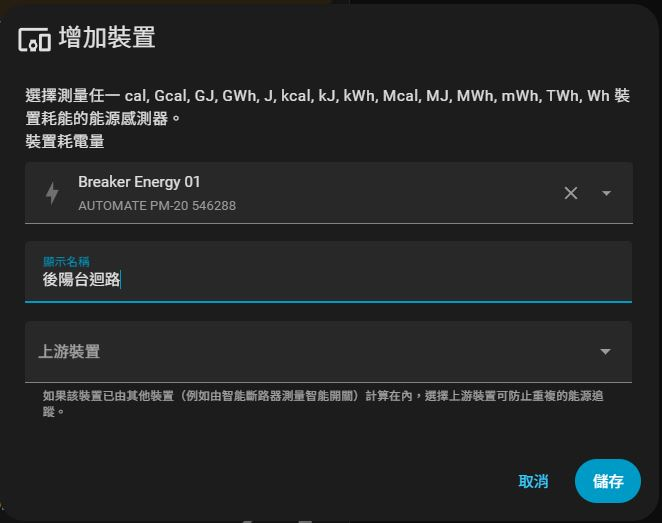
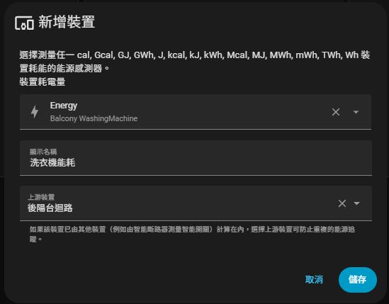

## 7. 實體說明
* (瀏覽器輸入ip位置即可顯示本頁面)
   
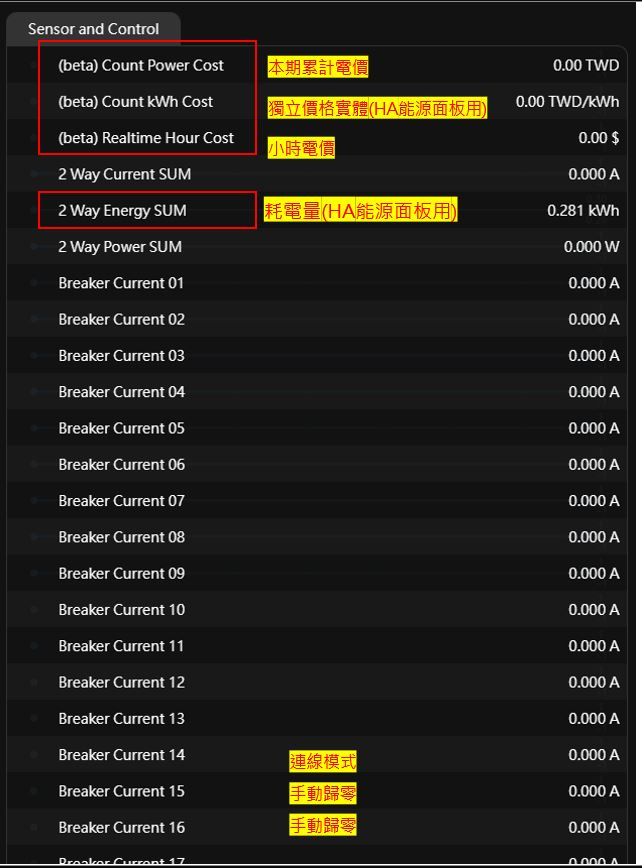

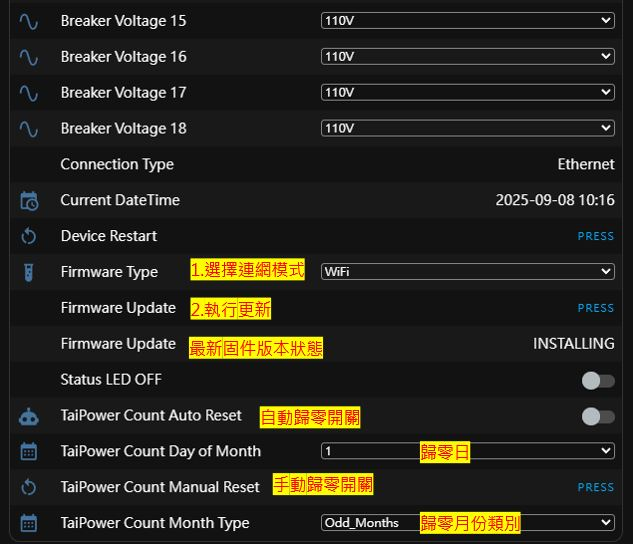

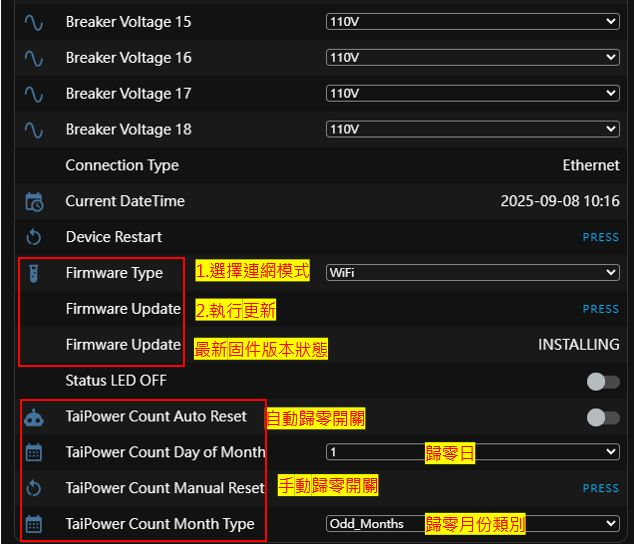

## 8. 設備自帶自動化計費週期歸零 
一般家用計費期間約2個月為一個週期，可以看一下繳費通知單上有寫，下圖是我家的範例
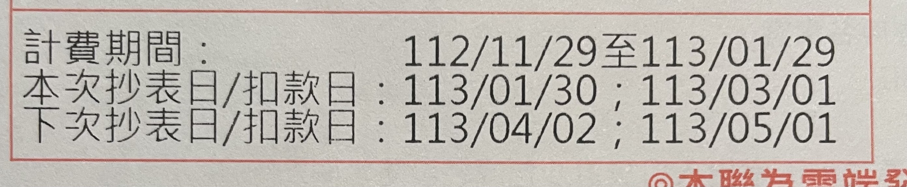

可以看出來我家可能是雙月的月初抄表的，所以在esphome裡面的設定內打開自動歸零模式並選擇雙月以及日期1即可。
** 注意若家裡是雙月份月底抄表的，日期要選28號。 **
* 搭配台電計價週期設定方式奇數月"Odd_Months" 偶數月 "Even_Months"，若每月要更新選 "Every_Month" (2、3階段計價模式適用見下方備註)
  
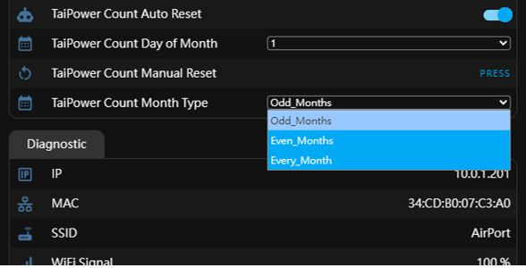
## 9. 切換聯網方式
* 先選擇"聯網方式"選單，再按"版本更新" log會出現0%~100%完成後因為連網方式變更IP也會跟著變動，若原本是網線變更為WIFI導致HA找不到設備，請手機搜尋再一次引導接入自家Wifi即可。

### 備註:
 * 針對營業用2段式或3段式計價模式請自行將 count_kwh_cost_storefront_2.yaml 或 count_kwh_cost_storefront_2.yaml
 * 複製到HA的 \config\packages 裡面(若沒有用過packages請自行建立並將以下程序碼新增於configuration.yaml檔案中然後重新載入yaml或重開機生效。)然後重新載入yaml或重開機生效。
 * 在設備後台歸零的選單請選擇每月，然後依據上述程序 "5.設定HA能源面板-電網把單價改成新生成的計價單位id即可"

  
         homeassistant:
           packages: !include_dir_named packages
           customize_domain:
             automation:
               initial_state: true
           allowlist_external_dirs:
             - /config

